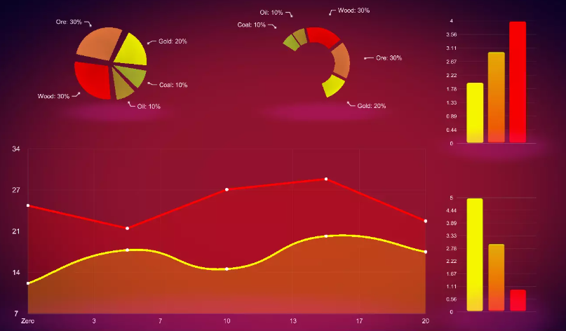

# Graph and Chart - Lite Edition

**The charting solution Unity developers have trusted for years. Now on GitHub.**

Graph and Chart is a robust, battle-tested data visualization asset for Unity, used by thousands of developers and highly acclaimed on the Unity Asset Store. It has been actively maintained and expanded since 2017, and this repository gives you the Lite Edition's source, free for individuals and companies with under **$200K annual revenue**.

[](https://assetstore.unity.com/packages/tools/gui/graph-and-chart-data-visualization-78488)
[](LICENSE.md)
[](#supported-unity-versions)
[](https://assetstore.unity.com/packages/tools/gui/graph-and-chart-data-visualization-78488)
[](https://assetstore.unity.com/packages/tools/gui/graph-and-chart-data-visualization-78488)

**[▶ Try the live demo in your browser](http://bitsplash.io/demoLite/index.html)** | **[Documentation](https://bitsplash.io/graph-and-chart)** | **[Tutorial video](https://www.youtube.com/watch?v=vrTBQ8Ingno&t=815s)**

[](http://bitsplash.io/demoLite/index.html)

---

## Getting Started

1. Clone this repository:

   ```
   git clone https://github.com/BitSplashIO/GraphAndChart.git
   ```

2. Copy the folder into your Unity project's `Assets` directory.
3. Add a chart to a UI canvas and customize it from the Inspector or from code.

[Live demo](http://bitsplash.io/demoLite/index.html) | [Documentation](https://bitsplash.io/graph-and-chart) | [Tutorial video](https://www.youtube.com/watch?v=vrTBQ8Ingno&t=815s)

## Supported Unity Versions

- **Unity 6 and above** (6000.x and later)
- **Unity 7 with CoreCLR**

This Lite Edition requires Unity 6 or newer.

---

## Why Graph and Chart?

Plenty of charting libraries can draw a line. Few have been through years of real projects, real bug reports, and real production use.

- **Proven.** Used by thousands of Unity developers in games, dashboards, simulations, training tools, and data apps.
- **Highly rated.** Highly acclaimed across 102 Asset Store reviews, and favorited by over 2,000 developers.
- **Actively maintained.** Continuously updated since 2017 with new charts, features, and Unity version support.
- **Real support.** Questions and issues go straight to the developers at [support@bitsplash.io](mailto:support@bitsplash.io), backed by a documentation portal and a support forum.
- **Made for Unity UI.** Charts live on your UI canvas (overlay, camera space, or world space) and work on every Unity platform, including mobile, desktop, web, and VR/AR.
- **Clear upgrade path.** Start free with this Lite Edition. Move up to the full or Scientific edition when your project needs it.

## What's in the Lite Edition

- 2D **graph (line)**, **bar**, **pie**, and **radar** charts
- **Full source code**
- Pan and zoom on graph charts, and support for large data samples
- Multiple groups and categories, plus bar animations, on bar charts
- 2D axis and legend prefab, with all features
- Interactive and event handling
- Editor preview, so you can design charts without pressing Play
- TextMeshPro integration
- Ready-made chart designs you can use as-is or customize
- Every feature customizable from both code and the editor

Want to see it running first? **[Open the live demo.](http://bitsplash.io/demoLite/index.html)**

## Graph and Chart vs. XCharts

[XCharts](https://github.com/XCharts-Team/XCharts) is a well-known free, MIT-licensed charting library for Unity, and a perfectly reasonable place to look. Here is how the two compare on the things that matter once a project gets serious.

| | **Graph and Chart** | **XCharts** |
| --- | --- | --- |
| Cost | Lite: free under $200K annual revenue. Full editions: one-time purchase on the Asset Store | Free (MIT) |
| Support | Direct developer support by email, documentation portal, support forum | GitHub issues and community groups; paid VIP support group |
| Track record | Maintained since 2017, trusted by thousands of users, highly acclaimed on the Asset Store | Open-source project |
| High-rate real-time data | **Scientific Edition** is purpose-built for large point counts (100k points, hardware dependent) and streaming sensor or waveform data | General-purpose charting |
| Upgrade path | Lite, Regular, and Scientific editions, each documented and supported | One library |
| Licensing for commercial use | Straightforward: free Lite under the revenue limit, or the standard Asset Store license for paid editions | MIT |

### Choose Graph and Chart when

- You want **a supported product** with a maintainer you can actually email, not just an issue tracker.
- You need **real-time or high-volume data**, such as sensor input, waveforms, or live streams (see the Scientific Edition).
- You want **ready-made designs** and a polished look quickly.
- You're building something **commercial** and want a vendor with a long track record behind the tool you depend on.

## Editions

| | **Lite** (this repo) | **Regular** | **Scientific** |
| --- | :---: | :---: | :---: |
| Where to get it | This repository | [Unity Asset Store](https://assetstore.unity.com/packages/tools/gui/graph-and-chart-data-visualization-78488) | [Unity Asset Store](https://assetstore.unity.com/packages/slug/195222) |
| Price | Free under $200K annual revenue | Paid | Paid |
| Best for | Trying it out, indie projects, small teams | Full-featured charting in games and apps | High-performance real-time graphs: large point counts, streaming data, sensor input, waveforms |
| **Performance and real-time** | | | |
| High-performance real-time streaming 2D graph | ❌ | ❌ | ✅ |
| Real-time streaming 2D graph | ❌ | ✅ | ✅ |
| **Core** | | | |
| Full source code | ✅ | ✅ | ✅ |
| Interactive and event handling | ✅ | ✅ | ✅ |
| Editor preview | ✅ | ✅ | ✅ |
| **2D graph chart** | | | |
| Pan and zoom | ✅ | ✅ | ✅ |
| Large data sample | ✅ | ✅ | ✅ |
| Streaming / real-time | ❌ | ✅ | ✅ |
| Graph animation | ❌ | ✅ | ✅ |
| **2D bar chart** | | | |
| Multiple groups and categories | ✅ | ✅ | ✅ |
| Bar animations | ✅ | ✅ | ✅ |
| Stacked bar charts | ❌ | ✅ | ✅ |
| **More chart types** | | | |
| 2D pie chart (all features) | ✅ | ✅ | ✅ |
| 2D radar chart (all features) | ✅ | ✅ | ✅ |
| 2D bubble chart (all features) | ❌ | ✅ | ✅ |
| 2D candle chart (all features) | ❌ | ✅ | ✅ |
| 3D charts (all features) | ❌ | ✅ | ✅ |
| **Components and data** | | | |
| 2D axis (all features) | ✅ | ✅ | ✅ |
| Legend prefab (all features) | ✅ | ✅ | ✅ * |
| Automatic loading of XML/JSON | ❌ | ✅ | ✅ * |
| **Asset integrations** | | | |
| TextMeshPro | ✅ | ✅ | ✅ * |
| Playmaker | ❌ | ✅ | ✅ * |

\* Supported on all charts except the high-performance chart.

**Outgrowing Lite?** The Regular edition adds real-time streaming, graph animation, stacked bars, bubble, candle, and 3D charts, XML/JSON loading, and Playmaker support. The Scientific edition adds the high-performance real-time graph on top of that.

- **[Graph and Chart (Regular Edition)](https://assetstore.unity.com/packages/tools/gui/graph-and-chart-data-visualization-78488)**: the full-featured version for games, apps, and dashboards.
- **[Graph and Chart - Scientific Edition](https://assetstore.unity.com/packages/slug/195222)**: a high-performance real-time graph chart built to handle large amounts of points. It also includes the regular Graph and Chart asset.

## License

This repository is released under the **[Graph and Chart Lite License](LICENSE.md)**.

In short:

- **Free** for individuals and companies with under **US$200,000** total revenue over the last 12 months, including in commercial products.
- At or above that revenue, you need to **buy the full version** of Graph and Chart, including for products you have already released.
- You may not resell or republish the Lite source on its own or inside a competing chart or graph asset.

This is a source-available license, not an open-source license. The summary above is only a convenience, and the full license text governs. The Lite Edition sold on the Asset Store is covered by the standard Unity Asset Store EULA instead.

## Support

Questions, requests, or issues? Contact [support@bitsplash.io](mailto:support@bitsplash.io).

## Upgrade

Ready for more charts, more performance, or a commercial license?

**[Get Graph and Chart on the Asset Store](https://assetstore.unity.com/packages/tools/gui/graph-and-chart-data-visualization-78488)** | **[Get the Scientific Edition](https://assetstore.unity.com/packages/slug/195222)**
